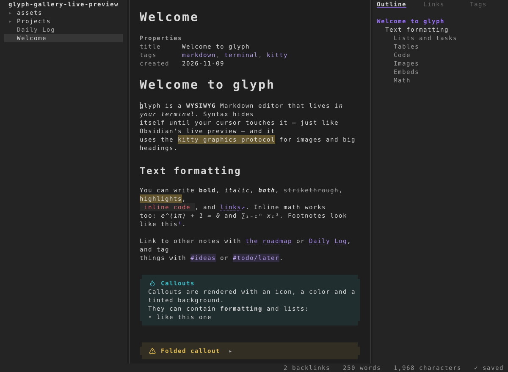
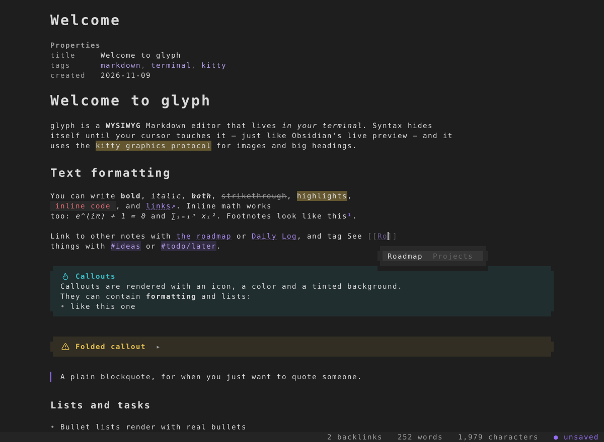
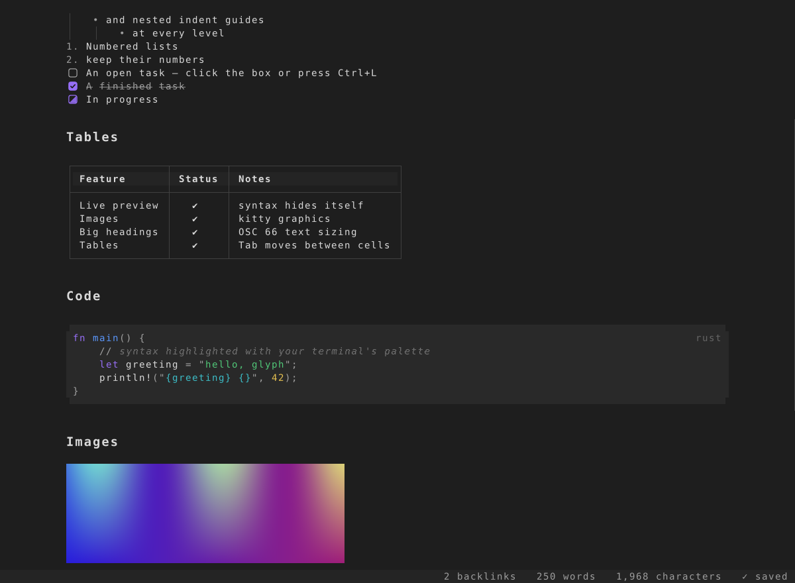
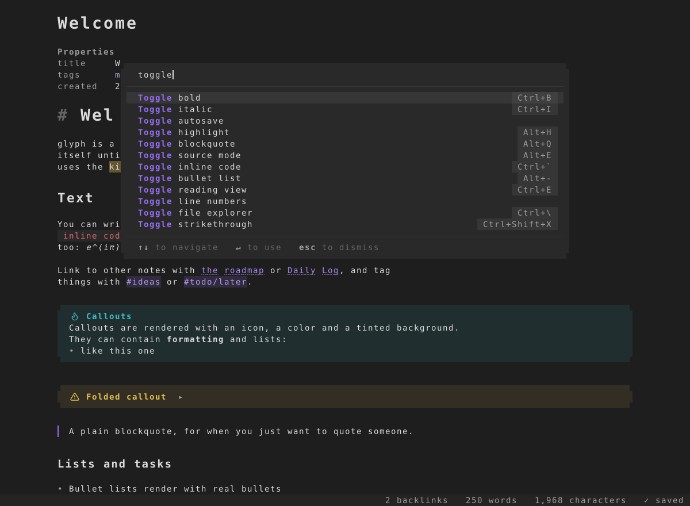
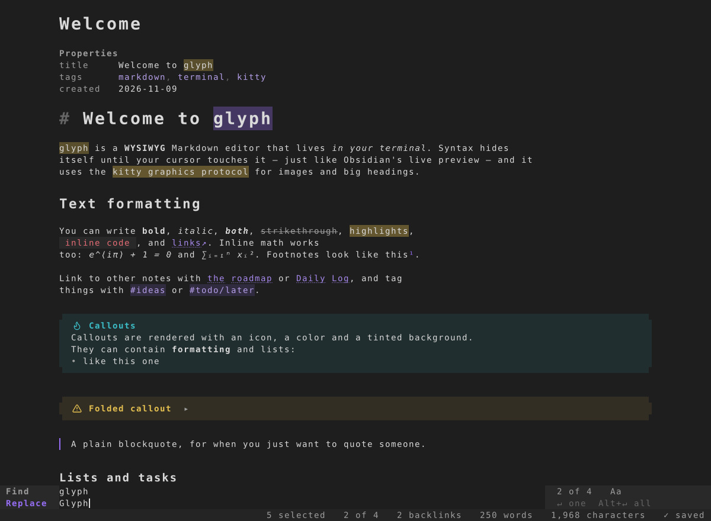
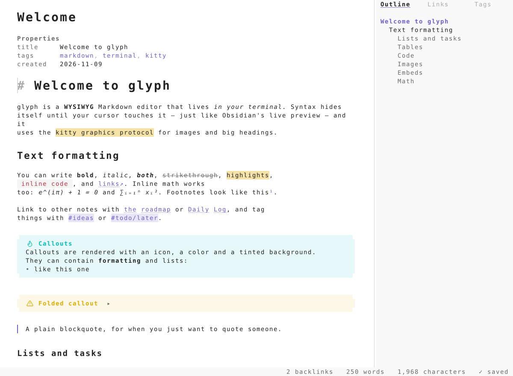
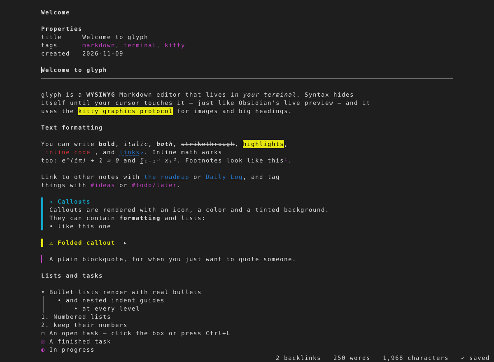

# glyph

**A WYSIWYG Markdown editor for the terminal**, with Obsidian-style live preview, plus inline
images and big headings via the
[kitty graphics protocol](https://sw.kovidgoyal.net/kitty/graphics-protocol/) and
[text sizing protocol](https://sw.kovidgoyal.net/kitty/text-sizing-protocol/).
It's one native Rust binary with micro-style keys, mouse support and no modes.



## Highlights

- **Live preview.** Markdown syntax hides itself until your cursor touches it, element by
  element: bold, links, code, math, list bullets and heading marks.
- **A real heading hierarchy.** On kitty 0.40+, H1 is 2×, H2 1.6× and H3 1.33×, close to
  Obsidian's scale. They use kitty's text-sizing protocol with fractional scaling (OSC 66
  `s/w/n/d`), and you can edit them in place with kitty's full-height cursor. Other
  graphics-capable terminals get headings drawn with a proportional font. Everywhere else they
  fall back to styled text.
- **Looks like Obsidian:**
  - an inline title (the note name, large, above the text)
  - callouts as rounded tinted boxes with the actual Lucide icons Obsidian uses
  - rounded checkboxes that fill with the accent colour when checked
  - code blocks as rounded panels, inline code as padded pills
  - an accent quote bar and external-link arrows
  - Properties shown as a clean key/value list
  - the command palette and quick switcher as floating panels with placeholder text,
    keycap hints and the "↑↓ to navigate · ↵ to use" footer
  - a status bar with backlinks · words · characters

  Icons and checkboxes are drawn with kitty graphics; other terminals get Unicode glyphs.
- **Inline images.** Supports ``, `![[image.png]]` (Obsidian embeds) and remote
  URLs, with `|300` or `|300x200` sizing. On kitty and Ghostty, images use Unicode placeholders,
  so they scroll and clip like text. Other kitty-protocol terminals get cropped placements.
- **Obsidian dialect:**
  - `[[wikilinks]]` with aliases and `#heading` anchors, and `![[note]]` transclusion
  - callouts (`> [!tip]`), foldable with `-` or `+`
  - `#tags`, `==highlights==`, `%%comments%%` and footnotes
  - task states (`[ ] [x] [/] [-] …`)
  - frontmatter shown as **Properties**
  - inline `$math$`, rendered to Unicode
- **Tables** render as box-drawn grids that wrap cell text. Tab and Shift+Tab move between
  cells and re-align the source.
- **Code blocks** get syntect highlighting, recoloured with *your terminal's* palette.
- **Smart editing:**
  - list, task and quote continuation, where Enter on an empty item ends the list
  - auto-pairs for brackets and backticks
  - a URL pasted over a selection becomes a link, and dropped image files become embeds
  - move, duplicate and join lines; Ctrl+B / Ctrl+I / Ctrl+K formatting
  - toggle a checkbox by clicking it or with `Ctrl+L`
- **Vault features:**
  - quick switcher with fuzzy search (`Ctrl+O`) and `[[` autocomplete
  - backlinks, outline, tags and full-text search (`Ctrl+Shift+F`)
  - rename that updates links (`F2`) and a daily note (`Alt+D`)
  - back/forward history (one note at a time, no tabs)
- **Terminal native.** glyph uses your terminal's own colours. It queries the palette
  (OSC 10/11/4) and derives its tints from it. Bundled themes: `dark`, `light`, `nord`,
  `gruvbox`.
- **Fast.** Incremental Markdown parsing and per-line layout caching keep a keystroke in an
  80,000-line document at about **0.05 ms**. The diffing renderer only sends changed rows,
  wrapped in synchronized-update markers.
- **Safe.** Saves are atomic, autosave is on by default (as in Obsidian), external changes to
  the file are detected, and the terminal is restored even if glyph panics.

| Editing with `[[` autocomplete | Tables, code, images, embeds |
|---|---|
|  |  |
| **Command palette** | **Find & replace** |
|  |  |
| **Light theme** | **Plain terminal (no graphics, unknown palette)** |
|  |  |

## Install

```sh
cargo install --path .      # or: cargo build --release && cp target/release/glyph ~/.local/bin/
```

Requires Rust 1.85+ (edition 2024). For heading images, glyph looks for Inter, DejaVu Sans or
Liberation Sans. Use `GLYPH_HEADING_FONT=/path/to/font.ttf` to pick a different font.

## Usage

```sh
glyph notes.md          # open a file (vault = nearest folder with .obsidian/ or .git/)
glyph ~/Notes           # open a vault: shows README/index or the quick switcher
glyph --read doc.md     # reading view
```

Options:

- `--theme terminal|dark|light|nord|gruvbox`
- `--headings osc66|image|plain`
- `--no-images`, `--no-remote-images`, `--no-autosave`
- `--source`, `--read`, `--line-numbers`
- `--width N`: readable line length (`0` = full width)

Config file `~/.config/glyph/config`:

```ini
theme = terminal
autosave = true
readable_width = 100
headings = auto        # osc66 | image | plain
images = true
remote_images = true
line_numbers = false
```

### Terminal support

| Terminal | Big headings | Images | Notes |
|---|---|---|---|
| kitty ≥ 0.40 | OSC 66 (editable in place) | Unicode placeholders | full experience |
| Ghostty | font-rendered images | Unicode placeholders | |
| WezTerm, Konsole, other kitty-graphics terminals | font-rendered images | cropped placements | |
| anything else | bold + rule | alt text | everything else works |

glyph detects capabilities at startup by querying the terminal, not by guessing from `$TERM`.

### Mouse

- Click places the cursor, drag selects, double-click selects a word, triple-click selects a line.
- Click a ☐ to toggle a task.
- Ctrl+Click follows links. In reading view a plain click does too.
- The wheel scrolls whatever is under the pointer.
- File tree, outline and palette entries are all clickable.

## Key bindings

`Ctrl+P` opens the command palette with every command, so the keys below are optional.
Arrows, Home/End and PgUp/PgDn move; add Shift to select, and Ctrl to move by word or paragraph.

| Action | Keys |
|---|---|
| Save file | `Ctrl+S` |
| Save all files | *palette* |
| Quit | `Ctrl+Q` |
| Undo | `Ctrl+Z` |
| Redo | `Ctrl+Y`, `Ctrl+Shift+Z` |
| Copy (line if no selection) | `Ctrl+C` |
| Cut (line if no selection) | `Ctrl+X` |
| Paste | `Ctrl+V` |
| Select all | `Ctrl+A` |
| Select line | `Ctrl+Shift+L` |
| Select word | `Alt+W` |
| Find in file | `Ctrl+F` |
| Find and replace | `Ctrl+H`, `Ctrl+R` |
| Find next | `F3` |
| Find previous | `Shift+F3` |
| Quick switcher: open note | `Ctrl+O` |
| Command palette | `Ctrl+P` |
| New note | `Ctrl+N` |
| Toggle reading view | `Ctrl+E` |
| Toggle source mode | `Alt+E` |
| Toggle file explorer | `Ctrl+\`, `Alt+B` |
| Toggle outline / backlinks panel | `Ctrl+Shift+\`, `Ctrl+\|`, `Alt+\` |
| Focus file explorer | `Alt+1` |
| Focus outline | `Alt+2` |
| Toggle bold | `Ctrl+B` |
| Toggle italic | `Ctrl+I` |
| Toggle strikethrough | `Ctrl+Shift+X`, `Alt+S` |
| Toggle highlight | `Alt+H` |
| Toggle inline code | `Ctrl+``, `Alt+`` |
| Insert markdown link | `Ctrl+K` |
| Insert wikilink | `Alt+K` |
| Toggle checklist status | `Ctrl+L`, `Ctrl+Enter` |
| Set paragraph (remove heading) | `Ctrl+0` |
| Heading 1 | `Ctrl+1` |
| Heading 2 | `Ctrl+2` |
| Heading 3 | `Ctrl+3` |
| Heading 4 | `Ctrl+4` |
| Heading 5 | `Ctrl+5` |
| Heading 6 | `Ctrl+6` |
| Cycle heading level | `Alt+#` |
| Toggle blockquote | `Alt+Q` |
| Toggle bullet list | `Alt+-` |
| Toggle numbered list | `Alt+N` |
| Insert code block | `Alt+C` |
| Insert table | `Alt+T` |
| Insert horizontal rule | *palette* |
| Move line up | `Alt+Up` |
| Move line down | `Alt+Down` |
| Duplicate line / selection | `Ctrl+D` |
| Delete line | `Ctrl+Shift+K`, `Ctrl+Shift+D` |
| Join lines | `Ctrl+J` |
| Outdent | `Ctrl+[` |
| Follow link under cursor | `Alt+Enter`, `F12` |
| Navigate back | `Alt+Left` |
| Navigate forward | `Alt+Right` |
| Go to line | `Ctrl+G` |
| Search all notes | `Ctrl+Shift+F` |
| Help: key bindings | `F1` |
| Format table | *palette* |
| Toggle line numbers | *palette* |
| Cycle theme | *palette* |
| Reload file from disk | *palette* |
| Rename note (updates links) | `F2` |
| Toggle autosave | *palette* |
| Toggle readable line length | *palette* |
| Suspend to shell | *palette* |
| Center cursor in view | *palette* |
| Scroll up | `Ctrl+Up` |
| Scroll down | `Ctrl+Down` |
| Open today's daily note | `Alt+D` |

Terminals without the kitty keyboard protocol can't distinguish a few chords from other keys
(`Ctrl+I`, `Ctrl+[`, `Ctrl+Shift+…`, `Ctrl+digit`). Use the palette or the `Alt` alternatives
instead.

## Development

```sh
cargo test                       # unit + integration + pty + chaos tests
cargo run --example gallery      # regenerate docs/screenshots through the virtual terminal
GLYPH_CHAOS_SEEDS=500 cargo test --release --test chaos   # longer randomised run
```

How the tests work:

- **Virtual terminal.** The suite drives the real application against `src/vt.rs`, a small
  terminal emulator that understands everything glyph emits: SGR, OSC 8/66/52, and kitty
  graphics with chunked transfers, Unicode placeholders and placements. It also renders PNG
  screenshots, so tests can assert on what a kitty user would actually see.
- **`tests/pty.rs`** runs the real binary in a pseudo-terminal and answers its capability probe
  the way kitty does.
- **`tests/chaos.rs`** fires randomised key, mouse, paste and resize sequences (down to 1×1
  terminals) and checks that nothing panics or corrupts state.
- **Parser fuzzing.** The incremental parser is fuzzed against a full re-parse.

Source map:

| Module | Role |
|---|---|
| `markdown.rs` | block + inline parser that keeps source byte offsets; incremental re-parse |
| `layout.rs` | source line → visual rows (concealment, wrapping, widgets, images); cursor ↔ screen mapping |
| `view.rs` | scrolling, drawing, selection and search highlights, hit-testing |
| `editor.rs` | buffer, cursor and Markdown-aware editing commands |
| `app.rs`, `ui.rs` | application state, events, overlays, chrome |
| `screen.rs`, `graphics.rs` | diffing renderer; kitty graphics + OSC 66 encoders |
| `term.rs`, `input.rs` | raw terminal, capability probe, key/mouse/paste decoding |
| `images.rs`, `highlight.rs`, `vault.rs` | image pipeline, syntax highlighting, note index |
